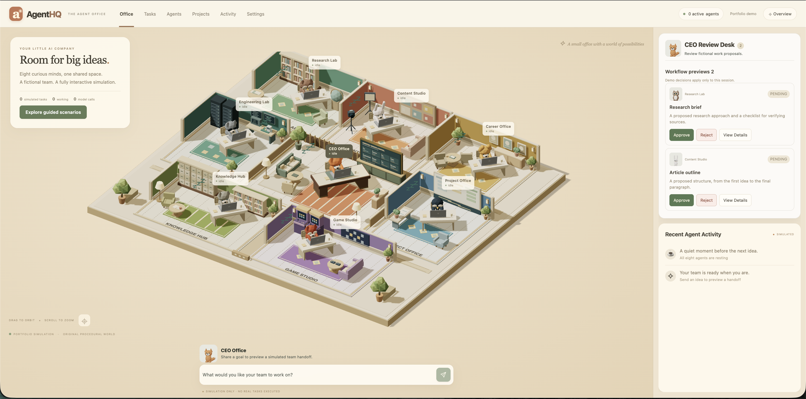
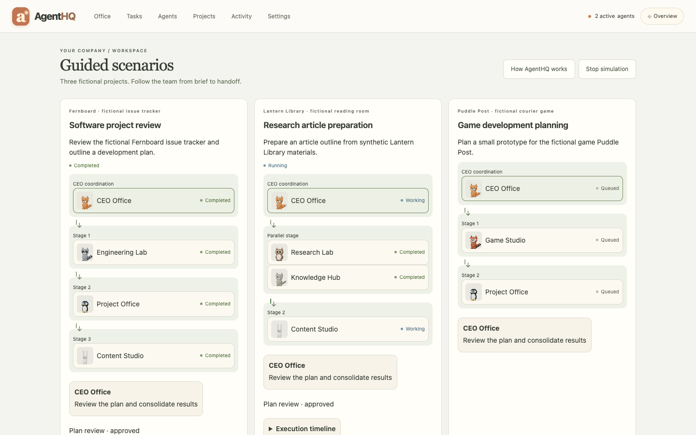
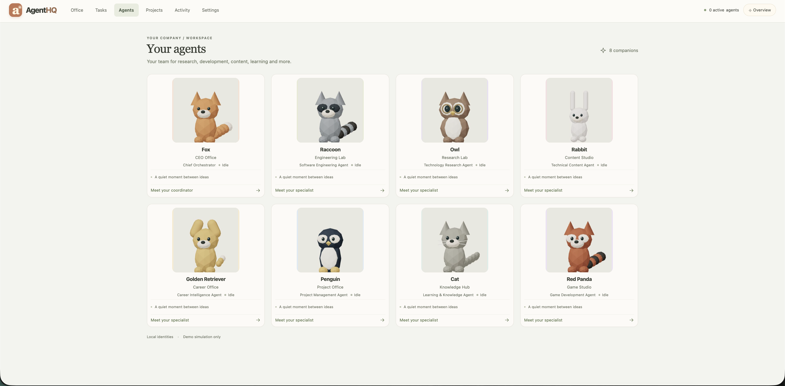
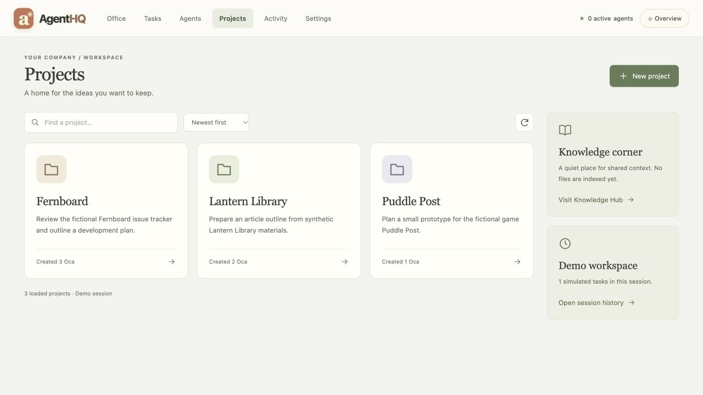

# AgentHQ — Personal Multi-Agent AI Platform

AgentHQ is a personalized multi-agent platform designed to delegate, coordinate, and manage everyday workflows through a team of specialized agents.

From software engineering and technical research to content creation, career development, project management, knowledge management, and game development, AgentHQ brings multiple disciplines together in a single interactive workspace.

A centralized CEO agent coordinates task delegation and collaboration between specialists, while a cozy 3D office provides a visual representation of the team's activities.

This repository contains the standalone, interactive public demo of AgentHQ. The original platform is privately maintained and under active development. The public version uses simulated workflows and synthetic data to showcase the platform's architecture and user experience.

---



## Try a guided handoff

1. From the office, choose **Explore guided scenarios** and run a fictional project.
2. Approve the proposed plan to start the simulated specialists. Reject it to stop before delegation, or use **Stop simulation** to cancel.
3. Select a node to inspect its role, follow the execution timeline, and open simulated deliverables. Copy or download a Markdown document from the scenario or its **Tasks** detail.
4. Browse **Agents** to try a prefilled example request. Choose **How AgentHQ works** on the scenario page to open the architecture showcase.

| Scenario | Simulated handoff |
| --- | --- |
| **Software project review** · Fernboard | Engineering reviews the sample architecture. Project sequences the work. Content outlines the report. |
| **Research article preparation** · Lantern Library | Research and Knowledge work in parallel. Content combines their fictional findings. |
| **Game development planning** · Puddle Post | Game sketches a prototype. Project turns it into milestones. |



[Sample deliverable preview](docs/screenshots/release/deliverable.png) · [Architecture showcase](docs/screenshots/release/architecture.png)

## Meet the team

| Department | Character | Role |
| --- | --- | --- |
| CEO Office | Fox | Coordinates the team and summarizes handoffs |
| Engineering Lab | Raccoon | Reviews sample architecture and implementation plans |
| Research Lab | Owl | Compares fictional source cards and explains uncertainty |
| Content Studio | Rabbit | Shapes findings into outlines and clear reports |
| Career Office | Golden retriever | Previews résumé and interview preparation |
| Project Office | Penguin | Turns ideas into milestones and dependencies |
| Knowledge Hub | Cat | Connects fictional notes and relevant references |
| Game Studio | Red panda | Sketches mechanics, levels, and playtests |



## Projects and session history

**Projects** starts with three fictional projects. Open a project to run its scenario and inspect completed simulation runs. Search, sorting, and additional projects operate on session data. **Tasks** exposes simulated task history and decisions. **Activity** reflects the current session’s events.



## Architecture and stack

React and TypeScript render the office and its panels. Three.js, React Three Fiber, and Drei provide the procedural scene and camera. Zustand keeps the current session’s conversations, task states, and activity in memory. A shared simulation adapter emits typed status, message, and activity events. The three guided workflows reuse that adapter interface and the same task store as CEO and Direct Mode conversations.

**Implemented here:** the 3D office, agent panels and chat previews, interactive workflow graphs and timelines, cancellations, simulated approval gates, Markdown deliverables, an architecture showcase, activity, and reduced-motion-aware agent animations. Desktop users can orbit and zoom. Mobile users can switch between the office and agent view. A department navigator and the simulation remain usable on browsers without WebGL.

**Private platform and roadmap:** workspace access, persistent tasks, provider settings, and real workflow endpoints are outside this demo. Future demo options include more fictional scenarios and a visual test matrix. Live LLM execution is outside the public simulation. All demo results are authored examples, and reloading clears the session.

## Run locally

Use Node.js 22 and npm.

```sh
npm ci
npm run dev
```

Open the URL printed by Vite. In the office, click a room or choose **Agents → Visit** to open a department. The **Chat** tab supports Direct Mode. The office composer always previews a CEO handoff.

```sh
npm run typecheck
npm test
npm run build
npm run verify:privacy
npm run preview
```

The production page uses a content security policy that denies API and other browser connections. JavaScript, styles, and portraits are served as same-origin static assets.

## Deployment and redistribution

The included [Vercel configuration](vercel.json) builds the project as a static Vite site with `npm run build` and serves `dist`. For a future deployment, choose **Vite** and **Node.js 22**, set the project root to this standalone source tree, and leave environment variables empty. Review the production preview and the [dependency and artwork notes](THIRD_PARTY_NOTICES.md) before publishing.

The portfolio release candidate uses the original procedural JPG portraits. The custom artwork supplied for the private platform remains outside this candidate pending public redistribution clearance. Third-party notices from the verified installation are included in the [runtime notice file](public/third-party-licenses.txt). The notice file includes the version-matched React Three Fiber notice and the Tailwind CSS notice. The custom WebP artwork requires separate redistribution clearance.

[Sample task results](docs/screenshots/release/simulated-results.jpg) · [Activity](docs/screenshots/release/activity.jpg) · [Settings](docs/screenshots/release/settings.jpg)
